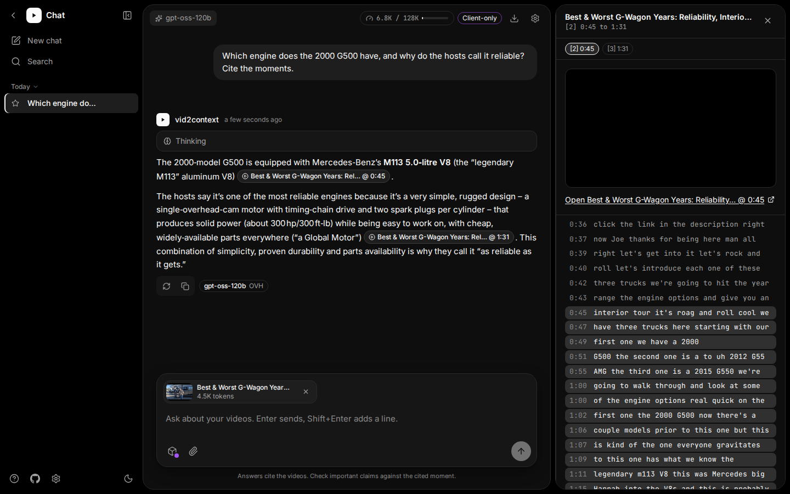
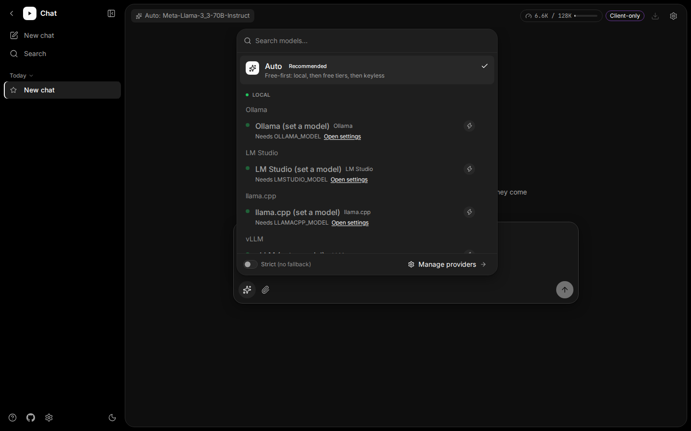
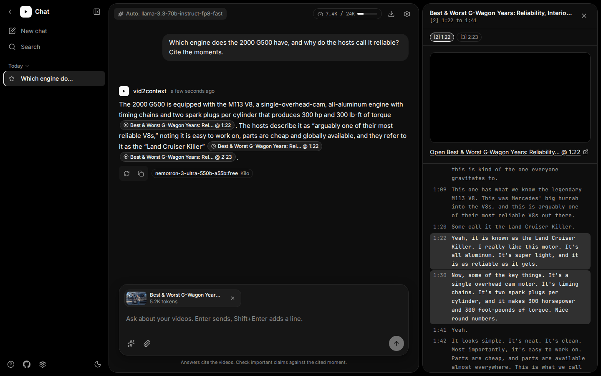

# Chat with your videos

The chat workspace at `/chat/` lets you attach videos, ask questions, and choose which model answers. Answers stream in, and each claim cites the moment it comes from: click a citation to open the video at that second, with the transcript around it highlighted.

## Start

- On a deployed site: open `/chat/`.
- Locally: `npm run dev:server` in one terminal, then `VID2CONTEXT_API=http://127.0.0.1:8787 npm run dev -w packages/chat` and open `http://localhost:5173/chat/`.
- From the web app: `/chat/?input=<video URL>` opens a new chat with that video attached, and `/chat/?collection=<id>` attaches a collection.

When no vid2context server answers, the workspace switches to [client-only mode](#client-only-mode) and shows a "Client-only" badge.

## Attach context

Click the paperclip, or "Attach context" in an empty chat. What you can attach depends on the mode:

| Server mode | Client-only mode |
|---|---|
| **Link**: any input the server accepts (YouTube, podcasts, pages with media) | **JSON files**: the output of `npx vid2context <url> --format json`, or `context.json` from a bundle |
| **Library**: videos the server already fetched | **Paste transcript**: YouTube's "Show transcript" text, SRT, WebVTT, or `[1:05] text` lines, with an optional video link so citations open the video |
| **Collections**: one collection per chat | |
| **Upload**: an audio or video file, when the server offers uploads | |

Each attachment shows as a chip above the message box with its thumbnail, title and estimated tokens. Remove it with the x. Sending is blocked until at least one video is attached, because answers are grounded in your videos.

## Ask

Type your question and press Enter (Shift+Enter adds a line). The answer streams in; Stop (or Esc) ends it and keeps what arrived. When a model exposes its reasoning, it sits in a collapsed "Thinking" section above the answer, never mixed into it.

Under each answer you see the model that wrote it, "fell back from ..." when a different model answered than the one you picked, and buttons to copy or regenerate. Your own messages can be copied, or edited and sent again, which replaces the answers after them.

If every model fails, the answer shows the error, a hint that says how to recover, and "Show details" with each model that was tried and why it failed, plus a Retry button.

## Pick a model

Open the picker with the model button next to the message box, or Alt+M.

- **Auto** (recommended) lets the chain choose free-first: models on your machine, then free tiers with your keys, then keyless hosts. Paid models run only when their key is set.
- Below Auto, models are grouped by tier (Local, Free, Keyless, Paid) and then by service. Each row shows capability icons (streaming, JSON output, structured output, vision, tools, reasoning; hover for names) and the context window (`128K`, `1M`).
- Greyed rows say what is missing, for example "Needs GROQ_API_KEY". Choosing one opens Settings in client-only mode, or the provider docs ([docs/providers.md](../providers.md)) in server mode.
- Search filters by name, service, tier or capability (`gpt-oss ovh`, `stream`, `keyless`).
- Star a model (hover the row, or Alt+S on the highlighted one) to pin it under Favorites.
- **Strict** in the footer means "this model or an error". Off (the default), your pick is tried first and the chain falls back if it fails.

Each chat remembers its model; new chats start with your last choice.

## Citations

Answers cite numbered transcript excerpts as `[n]`. The workspace shows each as a chip, "Title @ m:ss". When the server pins a citation to the quoted moment inside an excerpt, the chip uses that finer time. Clicking a chip opens the source panel:

- YouTube sources play in an embed from `youtube-nocookie.com`, starting at the cited second. The embed is created only after you click a chip. Other sources get a link.
- Below it, the transcript from a minute before to a minute after the citation, with the cited lines highlighted and scrolled into view.
- Chips at the top switch between the other sources the same answer cited.

## Token meter

The meter in the header estimates attached context plus the conversation, plus room for the answer, against the selected model's context window (with Auto, the model Auto would try first). It turns amber from 80% and red past 100%, and suggests the smallest larger-window model you can use, with a button to switch.

## Conversations

The sidebar groups chats by Pinned, Today, Yesterday, Previous 7 days and Older. Search matches titles, the last message and attached video titles. Pin with the star, rename, or delete. Everything stays in this browser (IndexedDB `v2c-chat`). The download button exports the chat as Markdown, with citations as timestamp links.

## Client-only mode

Client-only mode runs without any vid2context server, for example on GitHub Pages. The browser calls the models directly, with keys you enter under Settings, Provider keys. Keys stay in this browser's storage (IndexedDB `v2c-settings`) and are sent only to the provider each key belongs to. Nothing goes through vid2context servers. Keyless models need no key; turn them off in Settings if you do not want your questions and transcripts sent to those hosts.

Only services that allow requests from web pages can be used. Measured on 2026-11-14 from Chromium 158 by sending each API the request its provider makes (`packages/chat/scripts/cors-probe.mjs`):

| Service | Tier | Browser calls |
|---|---|---|
| Groq | free | allowed |
| Mistral | free | allowed |
| Gemini (OpenAI-compatible and native) | free | allowed |
| SiliconFlow | free | allowed |
| OpenRouter | free | allowed |
| OVH AI Endpoints | keyless | allowed |
| Pollinations | keyless | allowed |
| OpenAI | paid | allowed |
| Vertex AI (Gemini and Claude) | paid | allowed |
| Cerebras | free | blocked |
| GitHub Models | free | blocked |
| NVIDIA | free | blocked |
| SambaNova | free | blocked |
| Cloudflare Workers AI (REST) | free | blocked |
| Zhipu | free | blocked |
| Kilo | keyless | blocked |
| Anthropic | paid | blocked (the provider does not send Anthropic's browser opt-in header) |

Blocked services show greyed in the picker with "Its API blocks requests from web pages (CORS)". Services on your own machine (Ollama, LM Studio, llama.cpp, vLLM, Jan, LocalAI, a custom server) work once they allow this page's origin. For Ollama, add the origin to `OLLAMA_ORIGINS`; in LM Studio, turn on "Enable CORS". Set the model name (`OLLAMA_MODEL` and so on) under Settings. In-browser models (WebLLM, Chrome built-in AI) need no network.

## Keyboard

| Keys | Action |
|---|---|
| Ctrl+Shift+O (Cmd+Shift+O) | New chat |
| / or Shift+Esc | Focus the message box |
| Alt+M | Open the model picker |
| Esc | Stop the answer, or close a panel |
| Enter / Shift+Enter | Send / new line |
| Alt+S (in the picker) | Star the highlighted model |

The picker is a combobox over a listbox: arrows move, Enter picks, Esc closes. Every control has a label, and focus returns where it was when dialogs close.

## Screenshots

The screenshots come from the running app, taken by the Playwright suite (`SCREENSHOTS=1 LIVE=1 npm run e2e -w packages/chat`) on 2026-11-14. The video area in the source panel is dark because the screenshot is taken while the embedded player loads.
